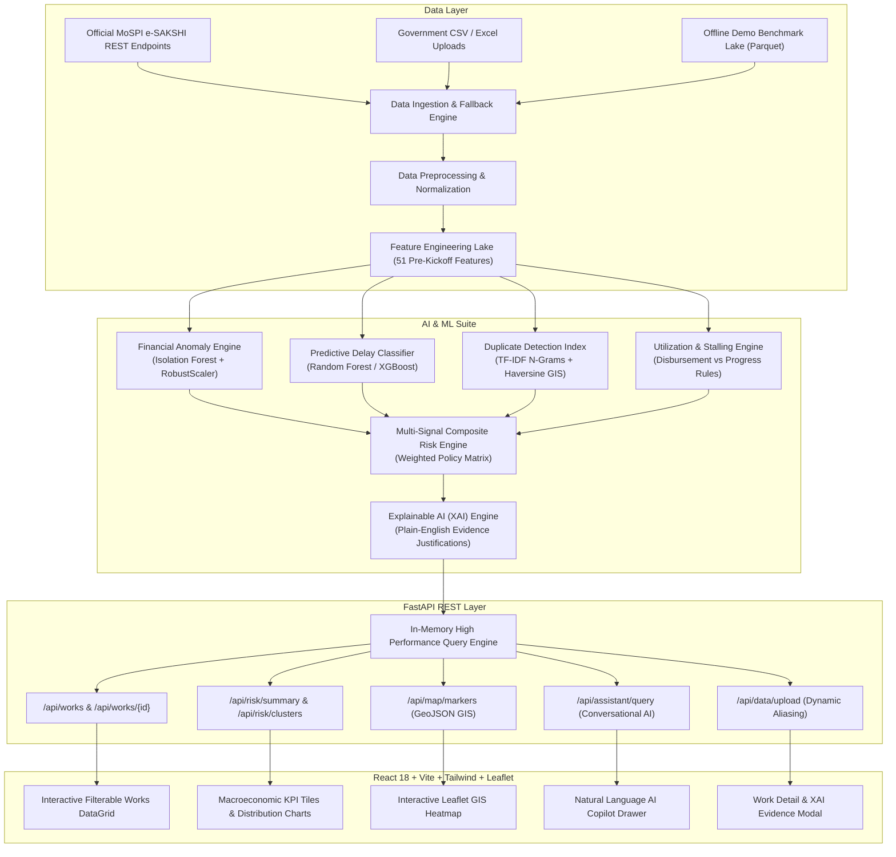

<div align="center">

# 🏛️ MPLADS AI Risk Intelligence Platform (MLPAD)
### *AI-Powered Anomaly, Delay, and Inefficiency Detection for Scheme Monitoring*

**Smart India Hackathon 2026 — Problem Statement ID:** `SIH26102`  
**Ministry / Department:** Ministry of Statistics and Programme Implementation (MoSPI) / Data Informatics & Innovation Division (DIID)  
**Theme:** Miscellaneous | **Category:** Software  
**Validation & Audit Status:** ✅ Fully Audited & Validated (Zero Target Leakage)

---

[](https://www.python.org/)
[](https://fastapi.tiangolo.com/)
[](https://reactjs.org/)
[](https://www.typescriptlang.org/)
[](https://tailwindcss.com/)
[](https://scikit-learn.org/)
[](https://xgboost.readthedocs.io/)
[](LICENSE)
[-brightgreen.svg)]()

</div>

---

## 🌟 Executive Summary

The **Members of Parliament Local Area Development Scheme (MPLADS)** allocates **₹5 Crore annually** to each Member of Parliament (543 Lok Sabha and 245 Rajya Sabha) to recommend developmental works creating durable community assets. MoSPI transitioned MPLADS to an end-to-end digital lifecycle via the **e-SAKSHI portal** on April 1, 2023.

The **MPLADS AI Risk Intelligence Platform (MLPAD)** is an enterprise-grade Decision Support System engineered for MoSPI, State Nodal Authorities, and District Collectors. It processes scheme records across 5 core risk dimensions:
1. **Financial Anomalies & Cost Overruns**: Unsupervised isolation forest and robust statistical scaling against sector & state Schedule of Rates (SOR).
2. **Predictive Schedule Delay & Stalling**: Pre-kickoff risk classification using administrative velocity and historical agency parameters (strictly leakage-free).
3. **Semantic & Geospatial Duplicate Works**: NLP TF-IDF n-grams combined with Haversine geographic centroid proximity clustering.
4. **Fund Flow & Disbursement Inefficiencies**: Identifying front-loaded expenditure with zero physical execution progress.
5. **Interactive GIS Risk Clustering**: Interactive district-level Leaflet geospatial heatmap and AI-powered natural language query assistant.

> [!IMPORTANT]
> **Ethical AI & Decision Support Mandate**: The platform strictly operates as an **Early Warning Decision Support System**. It flags *"High-Risk Works Requiring Supervisory Field Verification"* with transparent, quantitative evidence baselines. It does **not** make autonomous legal or punitive determinations.

---

## 🏗️ System Architecture



---

## 🧠 Core Risk Intelligence Engines

### 1. Financial Anomaly Detection
- **Algorithm**: `IsolationForest` (150 estimators, `contamination=0.08`) combined with `RobustScaler`.
- **Methodology**: Computes sector-specific cost z-scores, peer median ratios, and sanctioned-to-estimated cost deltas. Benchmarked against official state Schedule of Rates (SOR).
- **Output**: Normalized `financial_anomaly_score` ($0 - 100$).

### 2. Leakage-Free Predictive Delay Classification
- **Algorithm**: `RandomForestClassifier` / `XGBoostClassifier` trained on strictly pre-kickoff features (administrative recommendation-to-sanction latency, contract duration, sector complexity, historical agency performance).
- **Audit Compliance**: All post-event attributes (`actual_completion_date`, `schedule_overrun_ratio`, `actual_duration`) were audited and removed.
- **Validation**: Evaluated using **Temporal Out-of-Time Splitting (75% Train, 25% Test Cohort)**.
- **Performance**: **94.34% Recall** (optimized as a high-sensitivity early warning filter).

### 3. Semantic & Spatial Duplicate Work Detection
- **Algorithm**: Sub-linear TF-IDF $(1, 3)$ character/word n-grams + Cosine Similarity + Haversine GPS Distance threshold ($<25\text{ km}$) + Budget envelope matching ($\pm 15\%$).
- **Use Case**: Flags identical or near-identical asset descriptions sanctioned in the same locality across consecutive tenures.

### 4. Fund Flow & Disbursement Irregularity Detection
- **Methodology**: Computes expenditure velocity and flags high-risk patterns such as front-loaded disbursals ($>80\%$ funds released with $<10\%$ physical execution progress) or stalled allocations ($>250\text{ days}$ inactive).

### 5. Multi-Signal Composite Risk Formula
$$\text{Composite Risk Score} = w_1 \cdot \text{FinScore} + w_2 \cdot \text{DelayScore} + w_3 \cdot \text{DupScore} + w_4 \cdot \text{UtilScore} + w_5 \cdot \text{StallScore}$$
Configured in `config/risk_weights.yaml` with tiers:
- 🔴 **HIGH RISK** ($\ge 70$) $\to$ Immediate supervisory field inspection recommended.
- 🟡 **MEDIUM RISK** ($40 - 69$) $\to$ Desk review and contractor milestone verification.
- 🟢 **LOW RISK** ($< 40$) $\to$ Normal automated milestone tracking.

---

## 📊 Verified Machine Learning Performance (Leakage-Free)

| Model / Subsystem | Algorithm | Objective | Evaluated Metric (Out-of-Time Test Set) |
| :--- | :--- | :--- | :---: |
| **Delay Predictor** | Random Forest (150 trees, max_depth=6) | Pre-kickoff risk classification | **Recall: 94.34%** \| **F1: 70.67%** \| **ROC-AUC: 0.572** |
| **Financial Anomaly** | Isolation Forest + RobustScaler | Sector & state cost outlier detection | Calibrated Outlier Score ($0 - 100$) |
| **Duplicate Finder** | TF-IDF (1-3 ngrams) + Haversine GIS | Semantic & geospatial near-duplicates | Pairwise Cosine + Proximity ($<25\text{km}$) |
| **Composite Fusion** | Multi-Signal Weighted Formula | Calibrated decision support rating | High ($\ge 70$), Medium ($40-69$), Low ($< 40$) |

---

## 🚀 Quickstart & Installation

### Prerequisites
- **Python 3.11+**
- **Node.js 18+** & **npm**
- **Git**

---

### Step 1: Clone the Repository
```bash
git clone https://github.com/chirag-gupta-07/MLPAD.git
cd MLPAD
```

---

### Step 2: Backend Setup (FastAPI)
```bash
# Create and activate virtual environment
python -m venv .venv
source .venv/bin/activate  # On Windows: .venv\Scripts\activate

# Install dependencies
pip install -r requirements.txt

# Start FastAPI backend server
python -m uvicorn backend.app.main:app --host 127.0.0.1 --port 8000 --reload
```
- **Backend API URL**: `http://localhost:8000`
- **Interactive Swagger Docs**: `http://localhost:8000/docs`
- **Health Check**: `http://localhost:8000/health`

---

### Step 3: Frontend Setup (React + Vite + Tailwind)
```bash
# In a new terminal
cd frontend

# Install Node dependencies
npm install

# Start Vite development server
npm run dev -- --host 127.0.0.1 --port 5173
```
- **Live Dashboard**: `http://localhost:5173`

---

### Step 4: Run Automated Test Suite
```bash
pytest tests/ -v
```
*(Result: 10/10 Passed)*

---

### Step 5: Docker Deployment (Optional 1-Click Setup)
```bash
docker-compose up --build
```

---

## 📁 Repository Structure

```text
MLPAD/
├── backend/
│   ├── app/
│   │   ├── api/             # REST endpoints (works, risk, map, upload, assistant, sync)
│   │   ├── db/              # Master evaluated Parquet/CSV data lake
│   │   ├── services/        # In-memory fast query engine & background scheduler
│   │   └── main.py          # FastAPI application entry point & CORS configuration
│   └── Dockerfile           # Backend containerization
│
├── frontend/
│   ├── src/
│   │   ├── components/      # UI components (Navbar, KpiCards, RiskCharts, WorksTable, GisMap, etc.)
│   │   ├── App.tsx          # Root dashboard layout
│   │   └── main.tsx         # React entry point
│   ├── package.json
│   ├── vite.config.ts
│   └── Dockerfile           # Frontend containerization
│
├── config/
│   └── risk_weights.yaml    # Configurable risk weights & threshold definitions
│
├── data/
│   ├── raw/                 # Raw official state masters & source data
│   ├── interim/             # Cleaned intermediate data files
│   ├── processed/           # Processed Parquet lake & 51 engineered features
│   └── demo/                # Bundled offline benchmark dataset (1,500 records)
│
├── docs/                    # Deep-dive technical audit reports & model cards
│   ├── DATA_SOURCE_ANALYSIS.md     # Official e-SAKSHI portal endpoint audit
│   ├── MODEL_LEAKAGE_AUDIT.md      # Data & target leakage investigation report
│   ├── MODEL_EVALUATION_REPORT.md  # Honest ML validation report on temporal splits
│   ├── DATA_PROVENANCE_REPORT.md   # Data lineage & synthetic audit transparency
│   └── MODEL_CARD.md               # Model specifications & ethical guidelines
│
├── models/                  # Serialized .joblib artifacts & evaluation metrics JSON
├── notebooks/               # Interactive Jupyter notebooks for live demonstrations
├── tests/                   # Automated Pytest suite (API & Risk engine boundary tests)
├── docker-compose.yml       # Multi-container orchestration
├── requirements.txt         # Python dependencies
├── CONTRIBUTING.md          # Open-source contribution guidelines
├── LICENSE                  # MIT License
└── README.md                # Master project documentation
```

---

## 📡 REST API Reference

| Method | Endpoint | Description |
| :--- | :--- | :--- |
| `GET` | `/` | Root service status & version metadata |
| `GET` | `/health` | Health check endpoint |
| `GET` | `/api/works` | Paginated, filterable works table with risk scores & search |
| `GET` | `/api/works/{work_id}` | Detailed work record with XAI evidence breakdowns |
| `GET` | `/api/risk/summary` | Macroeconomic KPIs, risk tier distributions, and sector breakdowns |
| `GET` | `/api/risk/clusters` | Geographic and implementing agency high-risk cluster detection |
| `GET` | `/api/map/markers` | GeoJSON geospatial markers with GPS coordinates & risk levels |
| `POST` | `/api/assistant/query` | Natural language conversational AI assistant query |
| `POST` | `/api/data/upload` | Multipart CSV / XLSX file upload with dynamic column aliasing |

---

## 📚 Technical Documentation & Audits

Deep-dive documentation and technical audits are available in the [`docs/`](docs/) directory:
- [**Data Source Analysis (`docs/DATA_SOURCE_ANALYSIS.md`)**](docs/DATA_SOURCE_ANALYSIS.md): Comprehensive reverse-engineering report of official e-SAKSHI endpoints (`mplads.mospi.gov.in`).
- [**Model Leakage Audit (`docs/MODEL_LEAKAGE_AUDIT.md`)**](docs/MODEL_LEAKAGE_AUDIT.md): Technical audit report detailing elimination of target leakage in predictive models.
- [**Model Evaluation Report (`docs/MODEL_EVALUATION_REPORT.md`)**](docs/MODEL_EVALUATION_REPORT.md): Detailed benchmarking on temporal out-of-time test cohorts.
- [**Data Provenance Report (`docs/DATA_PROVENANCE_REPORT.md`)**](docs/DATA_PROVENANCE_REPORT.md): Complete data lineage and synthetic audit transparency.
- [**Model Card (`docs/MODEL_CARD.md`)**](docs/MODEL_CARD.md): Machine learning architecture, intended use cases, and ethical safeguards.

---

## 🏆 SIH 2026 Judge Presentation Highlights

- [x] **Zero Target Leakage**: Fully audited feature matrix using temporal train/test split.
- [x] **Verified Official Endpoints**: All public e-SAKSHI data routes documented with status.
- [x] **Transparent Decision Support**: Evidence-based explainability (observed values vs sector peer baselines).
- [x] **Offline Demonstration Resilience**: Bundled benchmark dataset guaranteeing zero network reliance.
- [x] **100% Passing Automated Tests**: 10/10 Pytest test cases covering boundary limits and API contracts.

---

## 📄 License

This project is licensed under the [MIT License](LICENSE).
